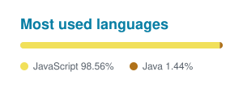
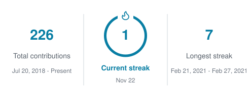

<picture>
  <source media="(prefers-color-scheme: dark)" srcset="assets/banner-dark.svg">
  
</picture>

## About me

- Currently working on **[Covid-19 Tracker](https://covid-19-tracker-e4bda.web.app/)**
- Currently learning **Data Structures and Algorithms**
- Looking to collaborate on **open-source projects**
- Reach me on **[LinkedIn](https://www.linkedin.com/in/subham-raoniar/)**
- Fun fact: I play games and go to the gym very often

## Stack

  <b>Backend</b> 
  <a href="https://www.java.com"><picture><source media="(prefers-color-scheme: dark)" srcset="assets/icons/dark/java.svg"></picture></a>
  <a href="https://spring.io/projects/spring-boot"><picture><source media="(prefers-color-scheme: dark)" srcset="assets/icons/dark/springboot.svg"></picture></a>
  <a href="https://www.python.org"><picture><source media="(prefers-color-scheme: dark)" srcset="assets/icons/dark/python.svg"></picture></a>
  <a href="https://nodejs.org"><picture><source media="(prefers-color-scheme: dark)" srcset="assets/icons/dark/nodejs.svg"></picture></a>
  <a href="https://expressjs.com"><picture><source media="(prefers-color-scheme: dark)" srcset="assets/icons/dark/express.svg"></picture></a>

  <b>Data</b> 
  <a href="https://www.mysql.com"><picture><source media="(prefers-color-scheme: dark)" srcset="assets/icons/dark/mysql.svg"></picture></a>
  <a href="https://firebase.google.com"><picture><source media="(prefers-color-scheme: dark)" srcset="assets/icons/dark/firebase.svg"></picture></a>

  <b>DevOps and tools</b> 
  <a href="https://www.jenkins.io"><picture><source media="(prefers-color-scheme: dark)" srcset="assets/icons/dark/jenkins.svg"></picture></a>
  <a href="https://git-scm.com"><picture><source media="(prefers-color-scheme: dark)" srcset="assets/icons/dark/git.svg"></picture></a>
  <a href="https://www.postman.com"><picture><source media="(prefers-color-scheme: dark)" srcset="assets/icons/dark/postman.svg"></picture></a>

  <b>Frontend</b> 
  <a href="https://developer.mozilla.org/en-US/docs/Web/JavaScript"><picture><source media="(prefers-color-scheme: dark)" srcset="assets/icons/dark/javascript.svg"></picture></a>
  <a href="https://developer.mozilla.org/en-US/docs/Web/HTML"><picture><source media="(prefers-color-scheme: dark)" srcset="assets/icons/dark/html.svg"></picture></a>
  <a href="https://developer.mozilla.org/en-US/docs/Web/CSS"><picture><source media="(prefers-color-scheme: dark)" srcset="assets/icons/dark/css.svg"></picture></a>
  <a href="https://getbootstrap.com"><picture><source media="(prefers-color-scheme: dark)" srcset="assets/icons/dark/bootstrap.svg"></picture></a>

## GitHub stats

  <picture><source media="(prefers-color-scheme: dark)" srcset="assets/stats/dark/stats.svg"></picture>
  <picture><source media="(prefers-color-scheme: dark)" srcset="assets/stats/dark/languages.svg"></picture>

  <picture><source media="(prefers-color-scheme: dark)" srcset="assets/stats/dark/streak.svg"></picture>

## Connect

  <a href="https://www.linkedin.com/in/subham-raoniar/"><picture><source media="(prefers-color-scheme: dark)" srcset="assets/social/dark/linkedin.svg"></picture></a>
  <a href="https://x.com/subhamraoniar"><picture><source media="(prefers-color-scheme: dark)" srcset="assets/social/dark/x.svg"></picture></a>
  <a href="https://www.youtube.com/channel/UC-NXT1lYAOPa3lrgWXqvuHA"><picture><source media="(prefers-color-scheme: dark)" srcset="assets/social/dark/youtube.svg"></picture></a>

## Views and followers

